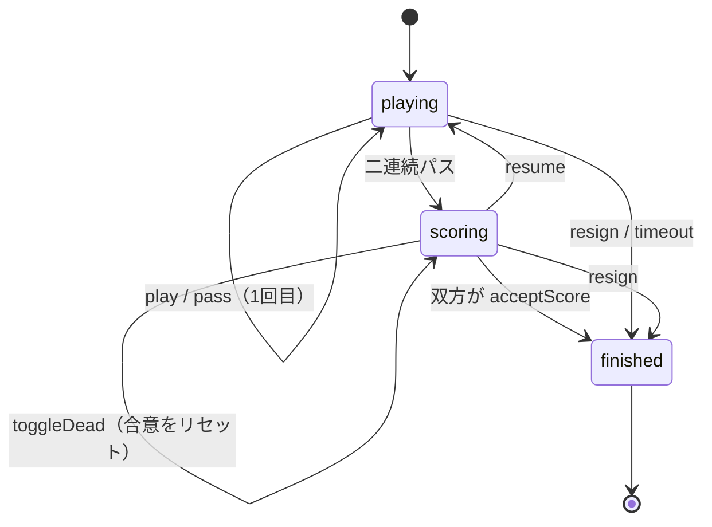

# 第2章 囲碁のルールをコードにする（ドメインロジック）

[← 第1章](01-typescript-monorepo.md) ｜ [目次](README.md) ｜ [次へ：第3章 REST API →](03-fastify-rest-api.md)

## この章で学ぶこと

- 囲碁の最低限のルールと、それをデータ構造で表す方法
- 盤面を1次元配列で持つ理由と、連（つながった石）を探すグラフ探索
- 状態遷移（対局中 → 整地 → 終局）をクラスで表す方法
- 持ち時間・レーティング・棋譜（SGF）の計算

ドメインロジック（業務のルール）を画面や通信から切り離して `packages/shared` にまとめているのが、このリポジトリの設計の要です。

## 1. 囲碁のルール（コードに必要な分だけ）

| 用語 | 意味 | コードでの扱い |
|---|---|---|
| 交点 | 石を置く場所。19路盤なら 19×19=361 点 | 配列の添字 `p` |
| 連 | 縦横につながった同じ色の石のまとまり | `Board.chain()` |
| 呼吸点 | 連に隣接する空いた交点 | `chain().liberties` |
| 取り | 相手の連の呼吸点が0になったら盤から取り除く | `Board.play()` |
| 自殺手 | 打った結果、自分の連の呼吸点が0になる手。禁止 | `'suicide'` |
| コウ | 1子を取り返し合う形。直後に取り返すのは禁止 | `koPoint` |
| 整地 | 対局後、死に石を取り除いて地を数える | `scoring.ts` |
| コミ | 先手の黒の有利を埋めるため白に足す点数 | `settings.komi` |

## 2. 盤面のデータ構造

### 2.1 1次元配列で持つ

```ts
// packages/shared/src/board.ts
/** Immutable Go board. Points are indexed as y * size + x. */
export class Board {
  readonly size: number;
  readonly cells: Uint8Array;      // 0=空, 1=黒, 2=白

  idx(x: number, y: number): number { return y * this.size + x; }
  xy(p: number): [number, number]  { return [p % this.size, Math.floor(p / this.size)]; }
```

2次元配列 `cells[y][x]` ではなく、1次元配列 `cells[y * size + x]` を使っています。

- 交点を数値1つで表せるので、通信（`game:move` の `point`）や保存（`moves`）が簡単になります。
- `Uint8Array` は1要素1バイトの型付き配列で、コピー（`slice()`）が速く、メモリも小さくて済みます。

### 2.2 隣の交点

```ts
neighbors(p: number): number[] {
  const s = this.size;
  const x = p % s;
  const out: number[] = [];
  if (x > 0) out.push(p - 1);            // 左（左端でなければ）
  if (x < s - 1) out.push(p + 1);        // 右
  if (p >= s) out.push(p - s);           // 上（最上段でなければ）
  if (p < s * (s - 1)) out.push(p + s);  // 下
  return out;
}
```

1次元配列では「左右の端をまたがない」チェックが大事です。`x > 0` を忘れると、左端の交点の「左」が1つ上の行の右端になってしまいます。

### 2.3 連と呼吸点を探す（深さ優先探索）

```ts
chain(p: number): { stones: number[]; liberties: Set<number> } {
  const color = this.cells[p];
  const stones: number[] = [];
  const liberties = new Set<number>();
  const seen = new Set<number>([p]);
  const stack = [p];
  while (stack.length) {
    const q = stack.pop()!;
    stones.push(q);
    for (const n of this.neighbors(q)) {
      const c = this.cells[n];
      if (c === EMPTY) liberties.add(n);                 // 空き → 呼吸点
      else if (c === color && !seen.has(n)) {            // 同じ色 → 連の一部
        seen.add(n);
        stack.push(n);
      }
    }
  }
  return { stones, liberties };
}
```

盤面を「交点を頂点、縦横の隣接を辺」とするグラフとみなした**深さ優先探索（DFS）**です。
再帰ではなく配列をスタックとして使っているので、大きな連でも呼び出しが深くなりすぎません。

### 2.4 一手打つ処理

```ts
play(p: number, color: Stone, koPoint = -1): PlayResult | MoveError {
  if (p < 0 || p >= this.cells.length) return 'out_of_bounds';
  if (this.cells[p] !== EMPTY) return 'occupied';
  if (p === koPoint) return 'ko';

  const cells = this.cells.slice();         // 元の盤面は変えない（イミュータブル）
  cells[p] = color;
  // ① 隣の相手の連で、呼吸点が0になったものを取る
  // ② 自分の連の呼吸点が0なら自殺手
  // ③ 1子で1子を取り、自分が当たり（呼吸点1）ならコウ
  ...
}
```

順番が重要です。**先に相手の石を取り、そのあとで自殺手を判定します**。
こうしないと「打った瞬間は呼吸点0だが、相手の石を取って呼吸点ができる手」を誤って禁止してしまいます。

`Board` は**イミュータブル（変更不可）**で、`play` は新しい `Board` を返します。
元の盤面が残るので、「打ってみて、だめなら元に戻す」処理や AI の読みに盤面を渡す処理が安全に書けます。

## 3. 対局の状態遷移（Game クラス）



```ts
// packages/shared/src/game.ts
play(color: Stone, p: number): GameError | null {
  if (this.phase !== 'playing') return 'wrong_phase';
  if (color !== this.toMove) return 'not_your_turn';
  ...
}
```

どのメソッドも最初に「今の状態でその操作ができるか」を確かめます。状態遷移を1か所にまとめると、サーバーは `game.play()` を呼ぶだけで正しい判定が得られます。

### 3.1 着手の記録から盤面を復元する

```ts
static fromMoves(settings: GameSettings, moves: Move[]): Game {
  const g = new Game(settings);
  for (const m of moves) {
    if (g.phase === 'scoring') g.resume();   // 整地中に次の手がある＝再開した
    const err = m.p === PASS ? g.pass(m.c) : g.play(m.c, m.p);
    if (err) throw new Error(`invalid move record at ${g.moves.length}: ${err}`);
  }
  return g;
}
```

DB には盤面ではなく**着手の列**だけを保存し、必要なときに最初から打ち直して盤面を作ります（イベントソーシングに近い考え方）。
サーバー再起動時の復元（`GameService.loadActive`）や棋譜再生はこの仕組みで動いています。

## 4. 整地（地の計算）

```ts
// packages/shared/src/scoring.ts の要点
// 空点のまとまりを塗りつぶし、接している石の色を OR で集める
} else borders |= c;      // 黒=1, 白=2 → 両方に接すると 3
...
if (borders === BLACK || borders === WHITE) { /* 片方の色だけに囲まれた → その色の地 */ }
```

黒が 1（二進数 01）、白が 2（二進数 10）なので、ビット OR を取ると「黒だけ＝1」「白だけ＝2」「両方＝3」と区別できます。値の選び方で判定が簡単になる良い例です。

| ルール | 黒の点数 | 白の点数 |
|---|---|---|
| 日本ルール | 地 ＋ アゲハマ（取った石と死に石） | 地 ＋ アゲハマ ＋ コミ |
| 中国ルール | 地 ＋ 盤上の石 | 地 ＋ 盤上の石 ＋ コミ |

## 5. 持ち時間

```ts
// packages/shared/src/clock.ts
export function chargeMove(s, c, elapsed) {
  if (elapsed >= timeUntilFlag(s, c)) return { clock: { main: 0, periods: 0 }, timedOut: true };
  if (s.type === 'fischer') {
    return { clock: { main: Math.min(c.main - elapsed + s.increment, s.maxTime), periods: 0 }, timedOut: false };
  }
  if (elapsed <= c.main) return { clock: { main: c.main - elapsed, periods: c.periods }, timedOut: false };
  const overflow = elapsed - c.main;
  return { clock: { main: 0, periods: c.periods - Math.floor(overflow / s.periodTime) }, timedOut: false };
}
```

| 方式 | 仕組み |
|---|---|
| 日本式秒読み | 持ち時間を使い切ると、1手ごとに決まった秒数（例: 30秒）で打つ。超えると回数を1回消費し、0回で負け |
| フィッシャー | 1手打つごとに時間が加算される（上限 `maxTime`） |

時刻は**ミリ秒の整数**で持ち、関数は副作用のない**純粋関数**です。現在時刻を引数で受け取るので、テストで時間を自由に進められます。

## 6. レーティング（Elo）

```ts
// packages/shared/src/rating.ts
export function expectedScore(a: number, b: number): number {
  return 1 / (1 + Math.pow(10, (b - a) / 400));     // a が b に勝つ期待値（0〜1）
}
// 新レート = 旧レート + K × (実際の結果 − 期待値)
```

- 2000点＝初段、100点ごとに1段級です。
- 対局数20局未満は K=40 で大きく動き、以降は K=20 で落ち着きます。
- 置き碁は1子を100点として黒のレートに足してから期待値を出します。

## 7. 棋譜（SGF）

SGF（Smart Game Format）は囲碁の棋譜の標準形式です。

```
(;GM[1]FF[4]CA[UTF-8]SZ[19]KM[6.5]RU[Japanese]PB[alice]PW[bob]RE[B+R]
;B[pd];W[dp];B[pp];W[dd])
```

座標は `a`〜`s` の2文字（列、行）です。`]` と `\` は値の中でエスケープが必要なので、`sgf.ts` の `escape` で処理しています。ユーザー名などの外部入力を形式に埋め込むときは、必ずエスケープを考えましょう。

## 練習問題

1. 9路盤で `p = 40` は (x, y) でいくつでしょうか。`neighbors(40)` が返す4点も求めてください。
2. `Board.play` の処理順を「先に自殺手判定、後で取り」に入れ替えると、どんな手が誤って禁止されるか、具体的な盤面で説明してください。
3. `packages/shared/test/engine.test.ts` にコウのテストを1つ追加しましょう（取り返しが `'ko'` になり、一手別の場所に打てば取り返せること）。`npm test -w @igo/shared` で実行できます（DB は不要です）。
4. `scoring.ts` のコメントにある「セキの中の眼を地に数えてしまう」制限は、なぜ起こるのでしょうか。

## 参考資料

- [日本棋院「囲碁のルール」](https://www.nihonkiin.or.jp/teach/)
- [Sensei's Library](https://senseis.xmp.net/)（囲碁用語の英語 wiki。Ko, Seki, Scoring など）
- [SGF File Format FF[4]](https://www.red-bean.com/sgf/)
- [Elo rating system（Wikipedia）](https://en.wikipedia.org/wiki/Elo_rating_system)
