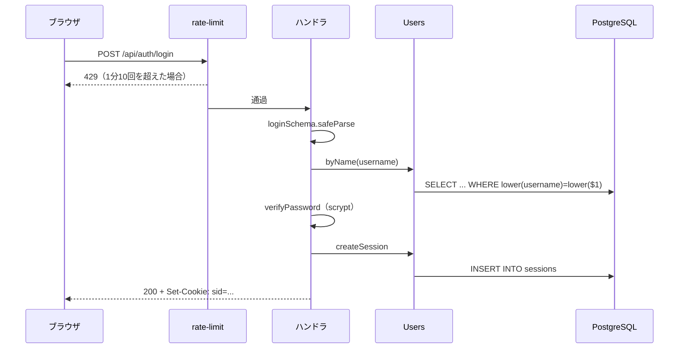

# 第3章 Fastify で REST API を作る

[← 第2章](02-go-rules-engine.md) ｜ [目次](README.md) ｜ [次へ：第4章 Socket.IO →](04-socketio-realtime.md)

## この章で学ぶこと

- Fastify のアプリケーション構造（インスタンス、プラグイン、ルート、フック）
- zod による入力検証と、エラーの返し方
- アプリを作る関数と起動する処理を分ける理由
- SPA の静的配信とフォールバック

## 1. Fastify とは

Fastify は Node.js の Web フレームワークです。Express と同じ用途ですが、次の特徴があります。

- 高速（JSON のシリアライズ最適化など）
- プラグインの仕組みが整理されている（`app.register`）
- `async` 関数の戻り値をそのままレスポンスにできる
- ロガー（pino）を内蔵

## 2. アプリを組み立てる関数と起動を分ける

```ts
// apps/server/src/index.ts（起動）
const config = loadConfig();
const db = createDb(config.databaseUrl);
await migrate(db);
const { app } = await buildApp(config, db);
await app.listen({ port: config.port, host: config.host });
```

```ts
// apps/server/src/app.ts（組み立て）
export async function buildApp(config: Config, db: Db, opts: AppOptions = {}) {
  const app = Fastify({ logger: process.env.NODE_ENV !== 'test', trustProxy: true });
  ...
  return { app, io, games, lobby };
}
```

`buildApp` は設定と DB を**引数で受け取ります**（依存性の注入）。テストでは別の DB、ポート0（空いているポートを自動で選ぶ）、テスト用の AI を渡して同じアプリを起動できます（第9章）。

設定は `config.ts` で環境変数から1回だけ読みます。`loadConfig(env = process.env)` と引数にしているので、テストでは `loadConfig({})` で既定値を得られます。

## 3. プラグイン

```ts
await app.register(cookie);                       // req.cookies, reply.setCookie を追加
await app.register(rateLimit, { global: false }); // ルートごとに回数制限を設定できるようにする
```

`global: false` にすると、回数制限は `config.rateLimit` を指定したルートだけにかかります。

```ts
const authLimit = { config: { rateLimit: { max: 10, timeWindow: '1 minute' } } };
app.post('/api/auth/login', authLimit, async (req, reply) => { ... });
```

## 4. ルートとハンドラ

```ts
app.get('/api/health', async () => ({ ok: true }));
```

`async` 関数が返したオブジェクトは、自動で JSON になって返されます。

### 4.1 パスパラメーターと型

```ts
app.get<{ Params: { id: string } }>('/api/games/:id', async (req, reply) => {
  if (!/^\d+$/.test(req.params.id)) return reply.code(404).send({ error: 'not_found' });
  const r = await db.query(`SELECT ... WHERE g.id = $1`, [req.params.id]);
  ...
});
```

- `app.get<{ Params: ... }>` の型引数で `req.params` に型が付きます。
- `games.id` は BIGINT なので、数字以外の文字列を DB に渡すとエラーになります。先に正規表現で弾いて 404 を返しています。

### 4.2 ヘッダーを付けて返す

```ts
return reply
  .header('content-type', 'application/x-go-sgf; charset=utf-8')
  .header('content-disposition', `attachment; filename="igo-${req.params.id}.sgf"`)
  .send(sgf);
```

`content-disposition: attachment` を付けると、ブラウザは表示せずにファイルとして保存します。

## 5. zod による入力検証

リクエストの body は**信用できない外部入力**です。型注釈を付けても実行時には何の保証もないので、実行時に検証します。

```ts
const registerSchema = z.object({
  username: z.string().regex(/^[A-Za-z0-9_]{3,16}$/),
  password: z.string().min(8).max(200),
  rank: z.string().regex(/^([1-9]|[12][0-9]|30)k$|^[1-9]d$/i),
});

app.post('/api/auth/register', authLimit, async (req, reply) => {
  const p = registerSchema.safeParse(req.body);
  if (!p.success) {
    const field = p.error.issues[0]?.path[0];
    const error = field === 'username' || field === 'password' || field === 'rank' ? `invalid_${field}` : 'invalid_input';
    return reply.code(400).send({ error });
  }
  // ここから先、p.data は { username: string; password: string; rank: string } 型
  ...
});
```

- `safeParse` は例外を投げず、`{ success, data | error }` を返します。
- 成功時の `p.data` には、スキーマから**自動で型が付きます**。型とバリデーションを二重に書かなくて済むのが zod の利点です。
- `password` の上限（200）は、極端に長い入力でハッシュ計算に時間をかけさせる攻撃を防ぐ意味もあります。

### 5.1 エラーの返し方

| 状況 | ステータス | body |
|---|---|---|
| 入力が不正 | 400 | `{ error: 'invalid_username' }` |
| 認証失敗 | 401 | `{ error: 'bad_credentials' }` |
| 見つからない | 404 | `{ error: 'not_found' }` |
| 重複 | 409 | `{ error: 'username_taken' }` |
| 回数超過 | 429 | プラグインが返す |

エラーは**機械が読めるコード**（`username_taken`）で返し、画面に出す日本語は web 側（`apps/web/src/api.ts` の `ERRORS`）で変換しています。サーバーが表示言語を知らなくて済み、多言語化もしやすくなります。

## 6. SPA の配信とフォールバック

```ts
if (config.webDist && existsSync(config.webDist)) {
  await app.register(fastifyStatic, { root: config.webDist, wildcard: false });
  app.setNotFoundHandler((req, reply) => {
    if (req.url.startsWith('/api/') || req.url.startsWith('/socket.io/')) {
      return reply.code(404).send({ error: 'not_found' });
    }
    return reply.sendFile('index.html');
  });
}
```

SPA では `/game/12` のような URL もブラウザ側のルーター（第7章）が処理します。
サーバーにそのファイルはないので、**見つからないときは `index.html` を返す**のが定石です。ただし API の 404 まで HTML にすると困るので、`/api/` は JSON の 404 を返しています。

> **注意**：`@fastify/static` 8.3.0 には既知の脆弱性があります。[解析レポート](../system-analysis.md#6-セキュリティ上の懸念点) を参照してください。

## 7. フックと終了処理

```ts
app.addHook('onClose', async () => {
  games.stop();   // タイマーと AI を止める
  io.close();     // WebSocket を閉じる
});
```

`app.close()` を呼ぶと `onClose` フックが実行されます。`index.ts` は SIGTERM（コンテナ停止時に送られる）を受けたら `app.close()` → `db.end()` の順で後片付けします。

## 8. リクエストの流れ（ログインの例）



## 練習問題

1. `GET /api/users/:username` に `?limit=10` のようなクエリで件数を指定できるようにするには、どう書けばよいでしょうか（`Querystring` の型引数と zod を使ってください）。上限を設けるべき理由も考えましょう。
2. `buildApp` が `config` を引数で受け取らず、中で `process.env` を直接読んでいたら、テストはどう書きにくくなるでしょうか。
3. `setNotFoundHandler` で `/api/` を除外しなかった場合、`fetch('/api/typo')` を呼んだ web 側で何が起きるでしょうか（`api.ts` の `request` 関数を読んで考えてください）。
4. Fastify のスキーマ機能（`schema: { body: ... }`）と zod を使う方法の違いを調べてみましょう。

## 参考資料

- [Fastify 公式ドキュメント](https://fastify.dev/docs/latest/)（Getting Started, Routes, Hooks, Plugins）
- [@fastify/rate-limit](https://github.com/fastify/fastify-rate-limit)
- [@fastify/static](https://github.com/fastify/fastify-static)
- [Zod 公式ドキュメント](https://zod.dev/)
- [MDN: HTTP レスポンスステータスコード](https://developer.mozilla.org/ja/docs/Web/HTTP/Status)
