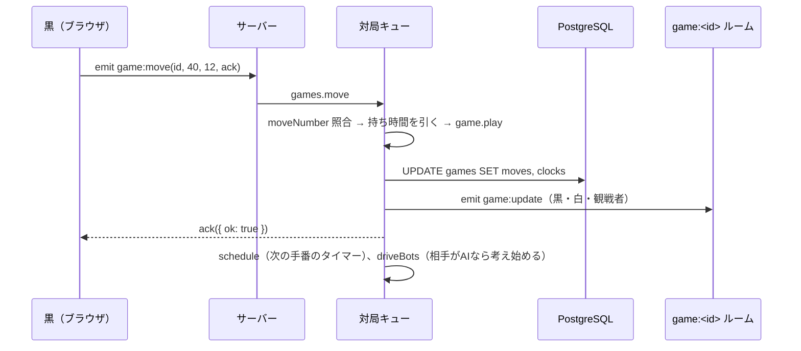

# 第4章 Socket.IO でリアルタイム通信

[← 第3章](03-fastify-rest-api.md) ｜ [目次](README.md) ｜ [次へ：第5章 PostgreSQL →](05-postgresql.md)

## この章で学ぶこと

- HTTP と WebSocket の違い、Socket.IO が追加するもの
- イベントと ack（返事）、ルームによる配信先の管理
- 通信の型をサーバーとクライアントで共有する方法
- 同時操作の直列化、サーバー時刻を正とする持ち時間の表示

## 1. なぜ WebSocket が必要か

HTTP は「クライアントが聞いたらサーバーが答える」方式です。対局では、**相手が打った瞬間にサーバーから知らせる**必要があります。
WebSocket は1本の接続を保ったまま、双方向にいつでもメッセージを送れる仕組みです。

Socket.IO は WebSocket の上に次の機能を加えたライブラリです。

| 機能 | 内容 |
|---|---|
| イベント | `emit('game:move', ...)` のように名前付きでメッセージを送る |
| ack | 送った側が返事を受け取るコールバック（HTTP のレスポンスに相当） |
| ルーム | 接続をグループに分け、グループ単位で送る |
| 自動再接続 | 切れたら自動でつなぎ直す |
| フォールバック | WebSocket が使えない環境では HTTP ロングポーリングで通信する |

## 2. 型を共有する

```ts
// packages/shared/src/protocol.ts
export interface ClientToServerEvents {
  'game:move': (gameId: string, point: number, moveNumber: number, ack: Ack) => void;
  ...
}
export interface ServerToClientEvents {
  'game:update': (game: GameView) => void;
  ...
}
```

```ts
// サーバー（apps/server/src/app.ts）
const io = new Server<ClientToServerEvents, ServerToClientEvents, {}, { user: PublicUser | null }>(app.server, ...);

// クライアント（apps/web/src/socket.ts）
export type IgoSocket = Socket<ServerToClientEvents, ClientToServerEvents>;
```

サーバーとクライアントで同じ型を使うので、イベント名や引数の食い違いがコンパイル時に見つかります。
ただし型は**コンパイル時だけ**のものです。悪意のあるクライアントは何でも送れるので、サーバー側では `Number(point)` や zod で実行時にも検証しています。

## 3. 接続時の認証（ミドルウェア）

```ts
io.use(async (socket, next) => {
  const token = app.parseCookie(socket.handshake.headers.cookie ?? '')[SESSION_COOKIE];
  const u = await users.bySession(token);
  socket.data.user = u ? toPublicUser(u) : null;   // 接続ごとのデータに保存
  next();
});
```

WebSocket の接続開始（ハンドシェイク）は HTTP リクエストなので、Cookie が送られます。REST と同じセッションでユーザーを特定し、`socket.data.user` に入れておきます。
未ログインでも接続は許可しています（観戦のため）。ログインが必要な操作は各イベントで `needUser` を使って確かめます。

ログイン・ログアウト後は Cookie が変わるので、クライアントは接続をつなぎ直します（`apps/web/src/socket.ts` の `resetSocket`）。

## 4. イベントと ack

```ts
// サーバー
socket.on('seek:cancel', safe((seekId, ack) => {
  const u = needUser(ack);
  if (!u) return;
  if (!lobby.cancelSeek(u.id, String(seekId))) return ack({ ok: false, error: 'no_such_seek' });
  ack({ ok: true });
  broadcastLobby();
}));
```

```ts
// クライアント：ack を Promise にする（apps/web/src/socket.ts）
export function call<T = {}>(ev: keyof ClientToServerEvents, ...args: unknown[]) {
  return new Promise((resolve) => {
    (getSocket().emit as any)(ev, ...args, resolve);   // 最後の引数が ack
  });
}
// 使う側
const r = await call('game:resign', view.id);
if (!r.ok) setError(errorText(r.error));
```

### 4.1 例外を ack に変える `safe`

```ts
const safe = <A extends unknown[]>(fn: (...args: A) => unknown) => (...args: A) => {
  const ack = args[args.length - 1];
  if (typeof ack !== 'function') return;            // ack がない呼び出しは無視
  Promise.resolve()
    .then(() => fn(...args))
    .catch((e) => {
      app.log.error(e);
      (ack as (r: unknown) => void)({ ok: false, error: 'server_error' });
    });
};
```

ハンドラの中で例外が起きても、プロセスを落とさず、クライアントには `server_error` を返します。
すべてのハンドラをこの関数で包むことで、エラー処理を1か所にまとめています（高階関数の活用例）。

## 5. ルームで配信先を管理する

| ルーム名 | 入る人 | 配信されるもの |
|---|---|---|
| `lobby` | ロビー画面を開いている人 | `lobby:state` |
| `game:<id>` | その対局の対局者と観戦者 | `game:update`, `game:chat` |
| `user:<id>` | そのユーザーの全接続（複数タブ） | `game:start` |

```ts
socket.join(userRoom(me.id));                                       // 接続時
io.to(gameRoom(g.id)).emit('game:update', games.view(g, ...));      // 一手ごと
io.to(userRoom(g.black.id)).to(userRoom(g.white.id)).emit('game:start', g.id); // 対局開始
```

`user:<id>` ルームのおかげで、同じ人が複数のタブを開いていても全部のタブに対局開始が届きます。

### 5.1 配信をまとめる（デバウンス）

```ts
let lobbyDirty = false;
const broadcastLobby = () => {
  if (lobbyDirty) return;          // すでに送る予定があれば何もしない
  lobbyDirty = true;
  setTimeout(() => {
    lobbyDirty = false;
    io.to('lobby').emit('lobby:state', lobbyState());
  }, 100);
};
```

人の出入りや募集が短い時間に続いても、100ms に1回だけ最新の状態を送ります。

## 6. 同時操作を直列化する

2人がほぼ同時に操作したり、時間切れのタイマーと着手が重なったりすると、状態が壊れるおそれがあります。
`GameService` は対局ごとに **Promise のキュー**を持ち、操作を1つずつ順番に実行します。

```ts
// apps/server/src/games.ts
const p = g.queue.then(run, run);   // 前の操作が終わってから（成功でも失敗でも）実行
g.queue = p.catch(() => {});        // 失敗してもキューを止めない
return p;
```

Node.js はシングルスレッドですが、`await`（DB への保存など）の間に別の処理が割り込みます。そのため、このような直列化が必要になります。

### 6.1 古い盤面に基づく操作を拒否する

```ts
move(id, userId, point, moveNumber) {
  return this.act(id, userId, true, (g, color) => {
    if (moveNumber !== g.game.moves.length) return 'stale_move';
    ...
```

クライアントは「何手目に打つつもりか」を一緒に送ります。通信の遅れで画面が古いまま打った手（ダブルクリックなど）を安全に拒否できます（楽観的並行性制御）。

## 7. サーバー時刻を正とする持ち時間

```ts
// サーバーが送る GameView
turnStartedAt: number | null;   // 手番が始まったサーバー時刻
serverNow: number;              // 送信した瞬間のサーバー時刻
```

```ts
// クライアント（apps/web/src/pages/GamePage.tsx）
setOffset(Date.now() - v.serverNow);                  // 手元の時計とのずれ
const elapsed = now - offset - view.turnStartedAt;   // サーバー時刻に換算した経過時間
```

パソコンの時計はずれていることがあるので、残り時間は**サーバーの時刻**で計算します。クライアントは表示用に 250ms ごとに描き直すだけで、時間切れの判定はサーバーのタイマー（`GameService.schedule`）が行います。

## 8. 一手が全員に届くまで



## 練習問題

1. 同じユーザーが2つのタブで同時に `game:move` を送ったとき、キューと `moveNumber` によってどう処理されるか説明してください。
2. 現在の `game:chat` は、ルームに入っていなくても、対局者でなくても送れます。「対局者と、その対局のルームにいる人だけ」に制限するには、どう書き換えればよいでしょうか（`socket.rooms` を使えます）。
3. サーバーを2台にすると、ルームへの配信はどうなるでしょうか。[Redis アダプタ](https://socket.io/docs/v4/redis-adapter/) で何が解決し、何が解決しないか（`GameService.live` はどうなるか）考えましょう。
4. `lobbyDirty` の仕組みを使わずに毎回すぐ送ると、100人が一度に接続したとき何回配信されるでしょうか。

## 参考資料

- [Socket.IO 公式ドキュメント v4](https://socket.io/docs/v4/)（Emitting events, Rooms, Middlewares, TypeScript）
- [MDN: WebSocket API](https://developer.mozilla.org/ja/docs/Web/API/WebSockets_API)
- [Node.js: The Node.js Event Loop](https://nodejs.org/en/learn/asynchronous-work/event-loop-timers-and-nexttick)
