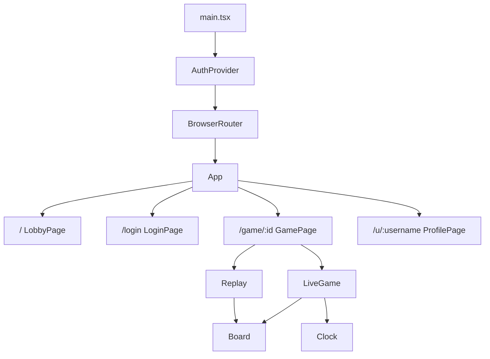

# 第7章 React と Vite でフロントエンド

[← 第6章](06-auth-security.md) ｜ [目次](README.md) ｜ [次へ：第8章 囲碁 AI →](08-ai-engines.md)

## この章で学ぶこと

- Vite の役割（開発サーバー、プロキシ、本番ビルド）
- React のコンポーネント、state、副作用（`useEffect`）、Context
- React Router による画面の切り替え
- SVG で盤面を描く方法と、サーバーからの更新を画面に反映する方法

## 1. Vite

Vite は開発用サーバーとビルドツールです。

| 場面 | Vite がすること |
|---|---|
| 開発（`npm run dev`） | TypeScript と JSX をその場で変換して配信。保存すると画面が自動で更新される |
| 開発時の通信 | `/api` と `/socket.io` を API サーバー（3000番）へ転送 |
| 本番（`npm run build`） | ファイルをまとめて圧縮し、`apps/web/dist/` に出力 |

```ts
// apps/web/vite.config.ts
server: {
  proxy: {
    '/api': api,
    '/socket.io': { target: api, ws: true },   // ws: true で WebSocket も転送
  },
},
```

プロキシのおかげで、ブラウザから見ると画面も API も同じオリジン（`localhost:5173`）になります。CORS の設定が不要で、Cookie もそのまま使えます。本番ではサーバーが `dist/` を配信するので、やはり同じオリジンです。

## 2. 起動とコンポーネントの階層

```tsx
// apps/web/src/main.tsx
createRoot(document.getElementById('root')!).render(
  <StrictMode>
    <AuthProvider>          {/* ログイン状態を配る */}
      <BrowserRouter>       {/* URL と画面を対応させる */}
        <App />
      </BrowserRouter>
    </AuthProvider>
  </StrictMode>,
);
```



`StrictMode` は開発時だけ、副作用を2回実行するなどして、後片付け忘れのバグを見つけやすくします。

## 3. ルーティング

```tsx
// apps/web/src/App.tsx
<Routes>
  <Route path="/" element={<LobbyPage />} />
  <Route path="/login" element={<LoginPage />} />
  <Route path="/game/:id" element={<GamePage />} />
  <Route path="/u/:username" element={<ProfilePage />} />
  <Route path="*" element={<p className="empty">ページが見つかりません</p>} />
</Routes>
```

```tsx
// GamePage.tsx
const { id = '' } = useParams();     // /game/12 なら id = '12'
```

ページを移っても HTML を読み直さず、JavaScript が画面を描き換えます（SPA）。そのため、サーバーは未知の URL に `index.html` を返す必要があります（第3章）。

## 4. Context でログイン状態を配る

```tsx
// apps/web/src/auth.tsx（要点）
const Ctx = createContext<AuthState | null>(null);

export function AuthProvider({ children }: { children: ReactNode }) {
  const [user, setUserState] = useState<PublicUser | null>(null);
  const refresh = useCallback(async () => {
    const r = await api.me().catch(() => ({ user: null }));
    setUserState(r.user);
    setLoading(false);
  }, []);
  useEffect(() => { void refresh(); }, [refresh]);   // 最初に1回 /api/me を呼ぶ
  ...
  return <Ctx.Provider value={{ user, loading, setUser, refresh, logout }}>{children}</Ctx.Provider>;
}

export function useAuth(): AuthState {
  const c = useContext(Ctx);
  if (!c) throw new Error('AuthProvider missing');
  return c;
}
```

どのコンポーネントからでも `const { user } = useAuth();` でログイン中のユーザーを取り出せます。props で何段も受け渡す必要がありません。
ログインの情報は Cookie（HttpOnly）にあり JavaScript からは読めないので、起動時に `/api/me` に聞いて調べています。

## 5. state と副作用（サーバーの更新を受け取る）

```tsx
// apps/web/src/pages/GamePage.tsx（要点）
function LiveGame({ initial }: { initial: GameView }) {
  const [view, setView] = useState(initial);
  const [now, setNow] = useState(Date.now());

  useEffect(() => {
    const s = getSocket();
    const onUpdate = (v: GameView) => {
      if (v.id !== initial.id) return;
      setView(v);                                   // state を変える → 再描画
    };
    s.on('game:update', onUpdate);
    const t = setInterval(() => setNow(Date.now()), 250);   // 時計の表示を進める
    return () => {                                  // 後片付け
      s.off('game:update', onUpdate);
      clearInterval(t);
    };
  }, [initial.id]);
  ...
}
```

- `useState`：値が変わると、そのコンポーネントが描き直されます。
- `useEffect`：描画のあとに実行する処理（購読、タイマーなど）を書きます。
- **後片付けの関数**を返すのが重要です。忘れると、画面を離れたあともイベントを受け続け、同じ処理が何重にも走ります。
- 第2引数の配列（`[initial.id]`）の値が変わったときだけ、後片付け → 再実行が起こります。

### 5.1 再接続したら入り直す

```tsx
// GamePage
const join = () => void call('game:join', id).then(...);
join();
s.on('connect', join);          // 接続が切れてつながり直したら、もう一度ルームに入る
return () => { s.off('connect', join); s.emit('game:leave', id); };
```

Socket.IO は自動で再接続しますが、サーバー側ではルームの所属が消えています。`connect` イベントで入り直すのが定石です。

### 5.2 ライブ対局と棋譜再生の切り替え

`game:join` が成功すれば対局中（`LiveGame`）、失敗すれば REST の `/api/games/:id` で記録を取り（`Replay`）、それもなければ「見つかりません」を表示します。
終局した対局はサーバーのメモリから消えるので、DB から読む仕組みに切り替わります。

## 6. SVG で盤面を描く

```tsx
// apps/web/src/components/Board.tsx（要点）
const m = 1.1;
const view = `${-m} ${-m} ${size - 1 + 2 * m} ${size - 1 + 2 * m}`;   // viewBox
for (let i = 0; i < size; i++) {
  lines.push(<line key={`h${i}`} x1={0} y1={i} x2={size - 1} y2={i} />);
  lines.push(<line key={`v${i}`} x1={i} y1={0} x2={i} y2={size - 1} />);
}
// 石は <circle cx={x} cy={y} ... />
```

`viewBox` で「1マス＝1単位」の座標系を作っているので、交点 (x, y) にそのまま石を置けます。SVG は拡大しても劣化せず、画面サイズに合わせて自動で伸び縮みします。

- `useMemo` で星の位置や死に石の Set を、入力が変わったときだけ作り直しています。
- 盤のロジック（どこが打てるか）は `@igo/shared` を使うので、画面側でルールを書き直していません。

## 7. API 呼び出しとエラー表示

```ts
// apps/web/src/api.ts
async function request<T>(path: string, init?: RequestInit): Promise<T> {
  const res = await fetch(path, {
    ...init,
    credentials: 'same-origin',      // 同じオリジンへは Cookie を送る
    headers: init?.body ? { 'content-type': 'application/json' } : undefined,
  });
  const body = await res.json().catch(() => ({}));
  if (!res.ok) throw new ApiError(body.error ?? `http_${res.status}`);
  return body as T;
}

export const errorText = (code: string) => ERRORS[code] ?? code;   // 'username_taken' → 日本語
```

## 8. Web Audio で効果音

```ts
// GamePage.tsx の clickSound（要点）
audio ??= new AudioContext();
const o = audio.createOscillator();                       // 音を作る
o.frequency.setValueAtTime(900, t);
o.frequency.exponentialRampToValueAtTime(200, t + 0.05);  // 高い音から急に下げる → 「カチッ」
```

音声ファイルを使わず、ブラウザの機能で石音を合成しています。`??=` は「まだなければ作る」という書き方です。

## 練習問題

1. `LiveGame` の `useEffect` から後片付けの `return` を消すと、対局画面を開いたり閉じたりしたときに何が起こるでしょうか。
2. 盤上にマウスを乗せたときに、その交点が打てない（すでに石がある、コウ）ならゴースト石を出さないようにするには、`@igo/shared` の何を使えばよいでしょうか。
3. 時計の表示は 250ms ごとに描き直しています。これを 1000ms にすると、秒読みの表示はどう見えるでしょうか。
4. `ProfilePage` で、自分の勝敗数（勝ち・負け）を集計して表示する機能を追加してみましょう。

## 参考資料

- [React 公式ドキュメント（日本語）](https://ja.react.dev/)（特に「エフェクトによる同期」「コンテクストで深くデータを受け渡す」）
- [React Router](https://reactrouter.com/)
- [Vite 公式ドキュメント](https://vite.dev/)（サーバーオプションの proxy）
- [MDN: SVG チュートリアル](https://developer.mozilla.org/ja/docs/Web/SVG/Tutorial)
- [MDN: Web Audio API](https://developer.mozilla.org/ja/docs/Web/API/Web_Audio_API)
