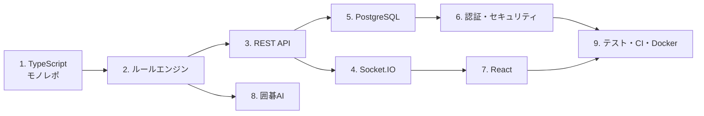

# igo-server で学ぶ Web アプリケーション開発

このリポジトリを教材にして、TypeScript による Web アプリケーション開発を学ぶためのガイドです。
各章は「基本の考え方 → このリポジトリでの使われ方（実際のコード）→ 練習問題 → 参考資料」の順に並んでいます。

## 前提知識

- JavaScript の基本文法（変数、関数、配列、オブジェクト、`async`/`await`）
- ターミナルの基本操作と Git の基本操作
- 囲碁のルールは知らなくても読めます。必要な部分は [2章](02-go-rules-engine.md) で説明します

## 章立て

| 章 | テーマ | 主に読むファイル | 目安 |
|---|---|---|---|
| [1](01-typescript-monorepo.md) | TypeScript とモノレポ（npm workspaces） | `package.json`, `tsconfig*.json` | 1〜2時間 |
| [2](02-go-rules-engine.md) | 囲碁のルールをコードにする（ドメインロジック） | `packages/shared/src/` | 2〜3時間 |
| [3](03-fastify-rest-api.md) | Fastify で REST API を作る | `apps/server/src/app.ts` | 2時間 |
| [4](04-socketio-realtime.md) | Socket.IO でリアルタイム通信 | `app.ts`, `games.ts`, `apps/web/src/socket.ts` | 2〜3時間 |
| [5](05-postgresql.md) | PostgreSQL とマイグレーション | `migrations/`, `db.ts`, `games.ts` | 2時間 |
| [6](06-auth-security.md) | 認証とセキュリティ | `users.ts`, `app.ts` | 2時間 |
| [7](07-react-vite.md) | React と Vite でフロントエンド | `apps/web/src/` | 2〜3時間 |
| [8](08-ai-engines.md) | 囲碁 AI（モンテカルロ探索と GTP） | `apps/server/src/ai/` | 3時間 |
| [9](09-testing-ci-docker.md) | テスト・CI・Docker | `test/`, `ci.yml`, `Dockerfile` | 2時間 |

## おすすめの進め方



- **バックエンドを学びたい人**：1 → 2 → 3 → 5 → 6 → 4 → 9
- **フロントエンドを学びたい人**：1 → 2 → 7 → 4
- **アルゴリズムに興味がある人**：1 → 2 → 8

## まず動かしてみる

学習の前に、手元で動かしておくとコードを読みながら試せます。手順はリポジトリ直下の [README](../../README.md#開発環境で動かす) にあります。

```bash
npm install
```

```bash
docker run -d --name igo-db -e POSTGRES_PASSWORD=postgres -e POSTGRES_DB=igo -p 127.0.0.1:5432:5432 postgres:16
```

```bash
npm run migrate
```

```bash
npm run dev
```

ブラウザで http://localhost:5173 を開き、ユーザーを登録して AI と1局打ってみてください。

## 関連ドキュメント

- [システム解析レポート](../system-analysis.md)：全体構成・DB・処理の流れ・セキュリティ上の懸念
- [技術要件書](../technical-requirements.md)：機能要件・非機能要件・API 仕様
