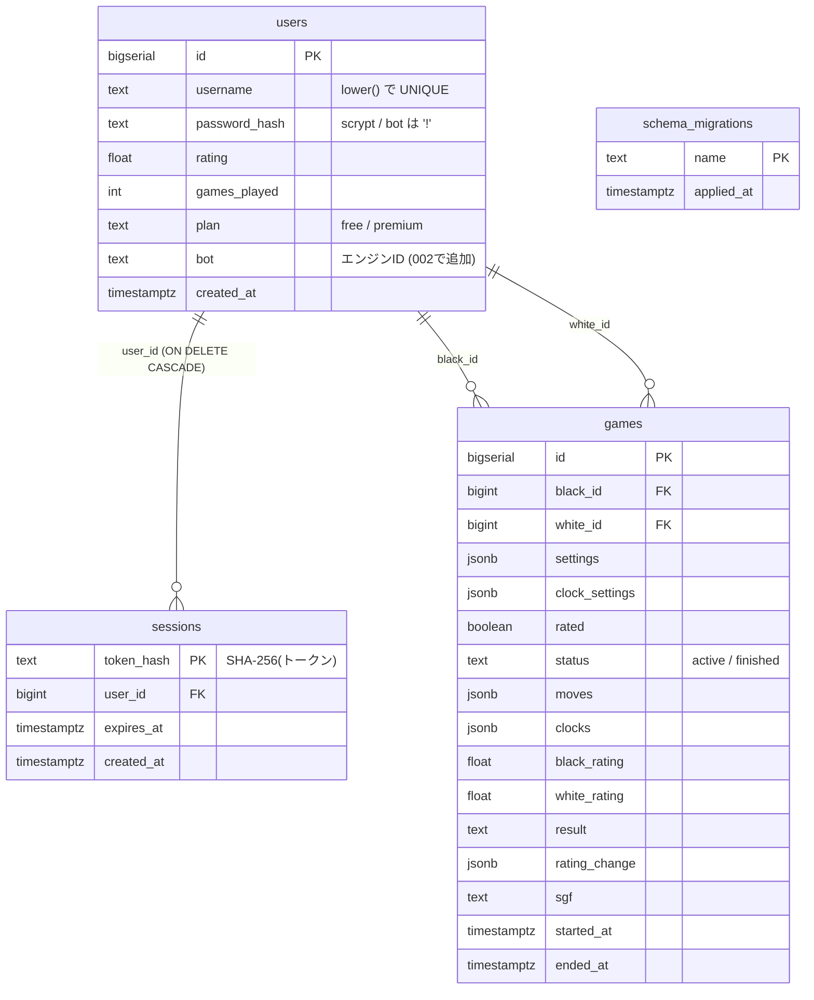
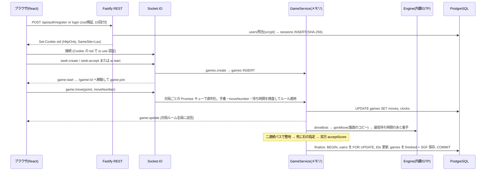
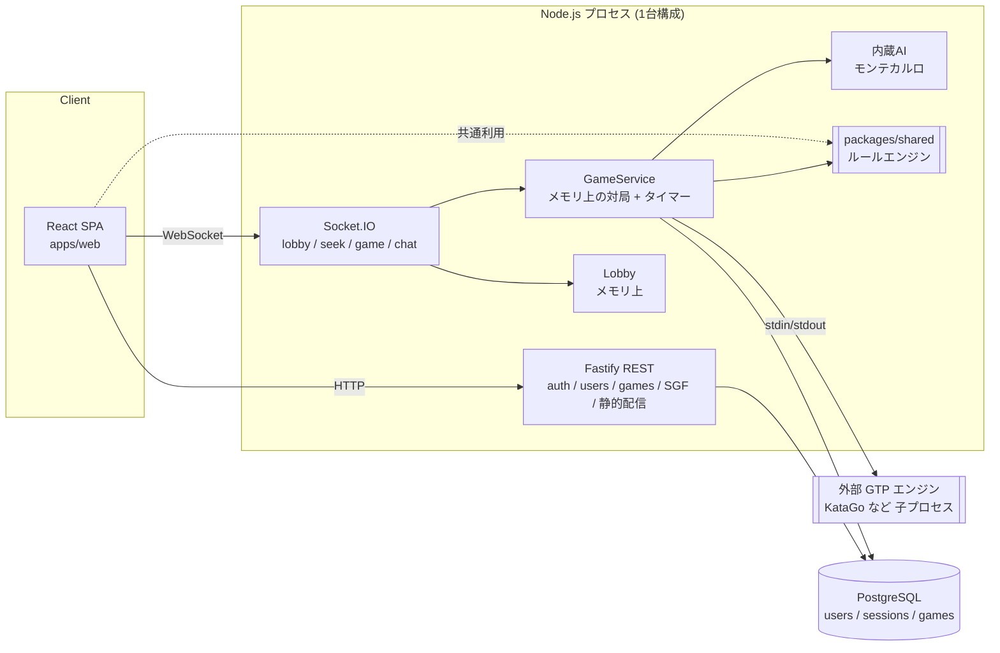

# igo-server システム解析レポート

> 調査日: 2026-11-05 / 対象コミット: `3c0c9b9`（人対AI・AI対AI の対局モードを追加）
> 調査方法: 全ソースの読解、`npm audit --omit=dev`、`npm outdated`。テストは PostgreSQL が必要なため未実行。

## 目次

1. [ディレクトリ構成](#1-ディレクトリ構成)
2. [言語・フレームワーク](#2-言語フレームワーク)
3. [データベースとテーブルの関連](#3-データベースとテーブルの関連)
4. [主要な処理の流れ](#4-主要な処理の流れ)
5. [外部 API・外部サーバーとの通信](#5-外部-api外部サーバーとの通信)
6. [セキュリティ上の懸念点](#6-セキュリティ上の懸念点)
7. [古いライブラリ・非推奨の機能](#7-古いライブラリ非推奨の機能)
8. [システム構成のまとめ](#8-システム構成のまとめ)
9. [改善候補（優先度順）](#9-改善候補優先度順)

---

## 1. ディレクトリ構成

npm workspaces で3パッケージに分けたモノレポです（ソースは約4,200行）。

```
igo-server/
├── package.json             # workspaces と dev/build/test/typecheck/migrate の一括スクリプト
├── tsconfig.base.json       # ES2022 / NodeNext / strict
├── Dockerfile               # 2段階ビルド (node:22-slim)、USER node
├── docker-compose.yml       # postgres:16 + app
├── .github/workflows/ci.yml # PostgreSQL サービス付きで build → typecheck → test
├── packages/shared/         # サーバーとブラウザで共通のロジック
│   └── src/
│       ├── board.ts         # 盤・取り・コウ
│       ├── game.ts          # 対局の状態遷移
│       ├── scoring.ts       # 日本/中国ルールの整地
│       ├── clock.ts         # 秒読み/フィッシャー
│       ├── sgf.ts           # 棋譜
│       ├── rating.ts        # Elo
│       └── protocol.ts      # Socket.IO の型
├── apps/server/             # Fastify + Socket.IO + PostgreSQL
│   ├── migrations/          # 001_init.sql, 002_bots.sql
│   ├── src/
│   │   ├── index.ts         # 起動
│   │   ├── app.ts           # REST と Socket のルーティング
│   │   ├── games.ts         # 対局サービス
│   │   ├── lobby.ts         # 募集とオンライン一覧（メモリ上）
│   │   ├── users.ts         # 認証
│   │   ├── db.ts / migrate.ts / config.ts
│   │   └── ai/
│   │       ├── engine.ts    # 共通インターフェース
│   │       ├── builtin.ts   # 内蔵モンテカルロAI
│   │       ├── gtp.ts       # 外部エンジン連携
│   │       └── index.ts     # エンジンの読み込み
│   └── test/                # server.test.ts, ai.test.ts, fixtures/fake-gtp.mjs
└── apps/web/                # React 19 + Vite の SPA
    └── src/                 # api.ts, socket.ts, auth.tsx, App.tsx, pages/, components/
```

## 2. 言語・フレームワーク

| 区分 | 使用技術 |
|---|---|
| 言語 | TypeScript 5.9（strict, ESM）、SQL |
| ランタイム | Node.js 22 |
| サーバー | Fastify 5.12、@fastify/cookie、@fastify/rate-limit、@fastify/static、Socket.IO 4.8、zod 4（入力検証）、pg 8（ドライバ直接、ORM なし） |
| フロント | React 19.3、react-router-dom 7、socket.io-client、Vite 8 |
| テスト・開発 | Vitest 4、tsx（watch 実行）、concurrently |
| インフラ | Docker、docker compose、PostgreSQL 16、GitHub Actions |

## 3. データベースとテーブルの関連



- AI も `users` の1行として登録されます（`bot` 列にエンジンID）。パスワードハッシュが `'!'` なのでログインはできません。
- `games.moves` は着手の配列を JSONB でまとめて持っています。一手ごとに配列全体を UPDATE するので、長い対局ほど書き込み量が増えます。
- 対局中の状態の正はメモリ上の `GameService.live` です。DB は永続化と再起動時の復元に使います。チャット、ロビーの募集、オンライン一覧は DB に保存されません。
- `status` 列に CHECK 制約がありません。期限切れのセッションを消す処理もありません。
- マイグレーションは起動時に自動で流れます（`pg_advisory_lock` で排他、ファイル単位のトランザクション）。

## 4. 主要な処理の流れ



- **時間切れ**：`schedule()` が手番側の残り時間ちょうどに `setTimeout` を仕掛け、切れたら負けにします。時間はサーバー側で管理しています。
- **再起動時の復元**：`loadActive()` が `status='active'` の対局を着手列から組み直します。手番側の持ち時間はこのとき計り直しになります。
- **AI**：内蔵 AI は RAVE 付きのフラットなモンテカルロ探索で、メインスレッド上で `setImmediate` を使って小分けに処理を返しながら動きます。GTP エンジンは子プロセスを起動して標準入出力で通信し、要求のたびに盤面全体を再生します。
- **REST API**：`/api/health`, `/api/me`, `/api/auth/*`, `/api/users/:username`（最新50局）, `/api/games/:id`, `/api/games/:id/sgf`。本番では SPA の静的ファイル配信も担います。

## 5. 外部 API・外部サーバーとの通信

| 通信先 | 場所 | 内容 |
|---|---|---|
| PostgreSQL | `apps/server/src/db.ts` | `pg.Pool`（max 10）。接続先は `DATABASE_URL` |
| 外部 GTP エンジン（KataGo など） | `apps/server/src/ai/gtp.ts` | `AI_GTP_ENGINES` で指定したコマンドを `spawn` で起動し、標準入出力で GTP 通信。タイムアウト時はプロセスを kill して次回起動し直す |
| ブラウザ → サーバー | `apps/web/src/api.ts`, `apps/web/src/socket.ts` | 同一オリジンへの fetch と Socket.IO（websocket を優先し、だめならポーリング） |
| 開発時のプロキシ | `apps/web/vite.config.ts` | `/api` と `/socket.io` を `API_URL`（既定 localhost:3000）へ転送 |

外部の HTTP API（決済、メール、分析など）との通信はありません。Stripe は README に構想として書かれているだけです。

## 6. セキュリティ上の懸念点

| 重要度 | 懸念 | 場所 | 内容と対策 |
|---|---|---|---|
| **高** | `@fastify/static` 8.3.0 に既知の脆弱性 | `apps/server/package.json` | `npm audit` で High 判定（パストラバーサル、エンコードされたパスでのルートガード回避など4件）。10.1.10 以上へ上げる |
| **高** | `trustProxy: true` を無条件に有効化 | `apps/server/src/app.ts` L44 | `X-Forwarded-For` を偽装すれば IP が変わるため、ログイン・登録の回数制限（IP 単位10回/分）を回避でき、総当たりや大量登録ができる。信頼するプロキシの段数か IP を指定する |
| 中 | Socket.IO で Origin を検証していない | `apps/server/src/app.ts` L57 | Cookie 認証の WebSocket なので、同一サイト扱いになる別サブドメインなどから Cross-Site WebSocket Hijacking を受けうる。`allowRequest` か `cors.origin` で Origin を確認する |
| 中 | Socket イベントに回数制限がない | `apps/server/src/app.ts` L288-408 | `game:chat` は対局者でもルーム未参加でも、どの対局にも投稿できる。チャット・募集・`ai:start` を連打できる。イベントごとの制限と、チャットは参加者だけに絞ることを検討する |
| 中 | CPU を使い切られるおそれ | `apps/server/src/ai/builtin.ts`, `app.ts` L340 | 人対AIは同時対局数に上限がない（1人1局でも複数アカウントで増やせる）。Lv3 は1手8,000回の試行を最大4秒、メインスレッドで行う。worker_threads に移すことと全体の同時実行数の上限を設ける |
| 中 | ログインの応答時間でユーザーの有無が分かる | `apps/server/src/app.ts` L136-137 | ユーザーがいないと scrypt を計算しないので応答が速い。ダミーのハッシュでも照合して時間をそろえる |
| 中 | 既定のDB認証情報と開発モードのまま | `apps/server/src/config.ts`, `docker-compose.yml` | 既定値が `postgres:postgres`。compose は `NODE_ENV=development` なので Cookie に Secure が付かない。本番では必須の環境変数にして、未設定なら起動しないようにする |
| 低 | セキュリティヘッダーがない | — | CSP、X-Frame-Options、HSTS などを返していない。`@fastify/helmet` の導入を推奨 |
| 低 | パスワードハッシュを不要な場面でも読み込む | `users.ts`, `app.ts` L187, `games.ts` L107 | `SELECT *` や `row_to_json(users)` が password_hash ごと取得する。今は `toPublicUser` で除いているが、ミスで漏れやすい。列を明示して取得する |
| 低 | セッション管理が最小限 | `apps/server/src/users.ts` | 期限切れの行が溜まり続ける。全端末ログアウトがない。回数制限もメモリ保持なので複数台構成では効かない |
| 低 | 並行処理の隙間 | `apps/server/src/app.ts` L312-336 | `userInGame` を確認してから `await games.create` するまでの間に別の受諾が入ると、同じ人が2局同時に対局になりうる |
| 情報 | 任意コマンドの実行 | `apps/server/src/ai/gtp.ts` | `AI_GTP_ENGINES` の指定どおりにプロセスを起動する。運用者が設定する前提なので問題ないが、環境変数を守る必要がある |

**対応状況（2026-11-13）**

次の項目は修正済みです。

- `@fastify/static` を 10.1.10 に更新（`npm audit` の指摘は 0 件。開発用の vitest も 4.1.12 に更新）
- `trustProxy` は既定で無効。環境変数 `TRUST_PROXY` で信頼するプロキシの段数か IP を指定する
- Socket.IO の接続時に Origin を確認（同じサイト、`ALLOWED_ORIGINS` のサイト、開発中はこのパソコン上のページだけ）
- Socket イベントに回数制限（チャット 5秒に3件、募集・受諾・AI 対局の開始 1分に10件、着手など 5秒に20件、参加 10秒に30件）。チャットはその対局を開いている人だけ
- ログインで存在しないユーザー名でもダミーのハッシュと照合し、応答時間をそろえる
- `NODE_ENV=production` で `DATABASE_URL` が未設定なら起動しない

**対策済みで良い点**

- SQL はすべてプレースホルダで渡しています。
- 入力は zod で検証しています。
- パスワードは scrypt にソルトを付けて保存し、比較は `timingSafeEqual` です。
- セッショントークンは32バイトの乱数で、DB には SHA-256 のハッシュだけを保存しています。
- Cookie は HttpOnly と SameSite=Lax です。
- React の自動エスケープを使い、`dangerouslySetInnerHTML` は使っていません。
- SGF の値もエスケープしています。

## 7. 古いライブラリ・非推奨の機能

| 対象 | 現在 | 推奨 |
|---|---|---|
| `@fastify/static` | 8.3.0（脆弱性あり。glob と minimatch も Moderate） | 10.1.10 以上（メジャー更新なので API 変更を確認する） |
| `@fastify/rate-limit` | 10.3.0 | 11.x |
| `@fastify/cookie` / `fastify` / `react-router-dom` | 11.1.3 / 5.12.7 / 7.18.4 | 11.1.5 / 5.12.8 / 7.18.5（パッチ更新） |
| Vite が2つ入っている | web は 8.3.5、ルートは vitest 経由で 7.3.7 | どちらかにそろえる |
| `react-router-dom` | v7 では互換用に残されたパッケージ | `react-router` 本体へ移行 |
| Node.js 22 / npm 10 | 保守フェーズの LTS | Node 24 LTS への移行を計画 |
| GitHub Actions | `checkout@v4`, `setup-node@v4` | 最新のメジャー版 |
| ESLint | コードに `eslint-disable` のコメントがあるのに設定も依存もない | ESLint を導入するか、コメントを削除する |

## 8. システム構成のまとめ



## 9. 改善候補（優先度順）

1. **すぐ対応（セキュリティ）**
   - `@fastify/static` を 10.x に上げる。
   - `trustProxy` を信頼するプロキシだけに限定する。
   - Socket.IO で Origin を検証する。
   - Socket イベントに回数制限を入れ、チャットは対局者と参加者だけにする。
2. **本番運用の準備**
   - `DATABASE_URL` と `NODE_ENV=production` を必須にする（既定の認証情報を外す）。
   - helmet でセキュリティヘッダーを付ける。
   - 期限切れセッションを定期的に削除する。
   - 監視とバックアップを用意する（README の計画どおり）。
3. **負荷対策**
   - 内蔵 AI を worker_threads に移し、AI 対局の総数に上限を設ける。
   - 1台構成からの拡張として、ロビー・回数制限・Socket アダプタを Redis に移す（README の計画どおり）。
4. **データモデル**
   - `games.moves` を毎回丸ごと更新するのをやめ、着手を追記する方式（別テーブルか `jsonb ||`）にする。
   - `status` に CHECK 制約を付ける。
   - 必要ならチャットも保存する。
   - `SELECT *` をやめて取得列を明示する。
5. **品質**
   - ログインの応答時間をそろえる。
   - 対局開始の並行処理の隙間を塞ぐ（ユーザー単位のロックか DB の部分ユニーク制約）。
   - ESLint を導入し、Vite のバージョンをそろえ、依存パッケージのパッチを当てる。
   - CI に `npm audit` を加え、Actions を更新する。
   - 再起動時に持ち時間が計り直しになる仕様を見直す。
